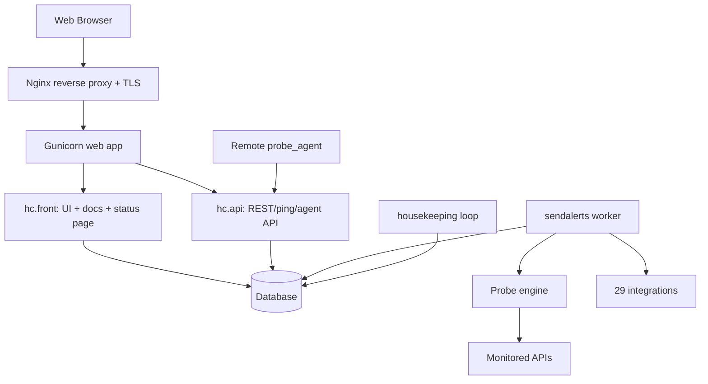
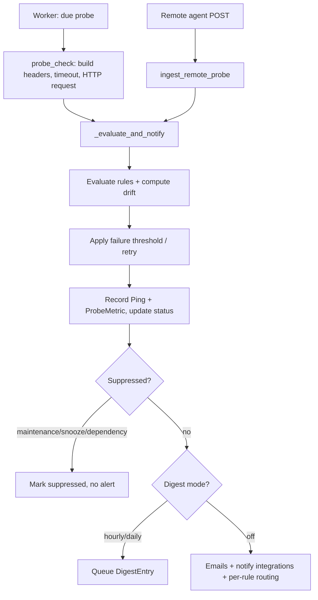

# Project Documentation — Healthchecks (Active API Monitoring Platform)

A self-hosted monitoring system built on top of **Healthchecks** (the open-source
cron-job monitor). It keeps all original cron/ping monitoring and adds a complete
**active API probing platform**: Healthchecks itself calls your APIs on a
schedule, validates the responses against configurable rules, tracks history and
latency, applies alert policies, and delivers rich, unified notifications through
29 integrations — plus multi-location probing agents and production hardening.

Written in **Python 3.12 / Django 6.1**, backed by **SQLite (dev) or PostgreSQL
(prod)**, served by **Gunicorn behind Nginx**, with three systemd-managed
processes.

---

## 1. Architecture at a glance



### Django apps
| App | Responsibility |
|---|---|
| `hc/api` | Core models (Check, Ping, Flip, Channel, Notification, ProbeMetric, DigestEntry, MaintenanceWindow), the REST/ping/agent API, the **probe engine** (`probes.py`), the **rules engine** (`rules.py`), and all transports. |
| `hc/front` | Web dashboard, check/probe configuration UI, rules playground, public status page, notification-errors page, and the built-in documentation site. |
| `hc/accounts` | Users, profiles, projects, team members + roles, project transfer, WebAuthn/TOTP 2FA, login/signup. |
| `hc/integrations/*` | 29 notification transports (one package each). |
| `hc/lib` | Helpers: `curl` wrapper, email renderer, S3 offload, badges, signing, WebAuthn, dates, statsd. |
| `hc/logs` | Admin-visible request/event logging. |
| `hc/payments` | Optional billing (disabled by default). |

### Processes (systemd units in `deploy/`)
1. **web** — Gunicorn (`hc.wsgi`) serving UI + API on `127.0.0.1:8001`.
2. **worker** — `manage.py sendalerts`: the heart. Loops over due checks, runs
   due probes, processes flips -> notifications, flushes digests, handles
   escalations, retries failed notifications, and pings watchdog checks.
3. **housekeeping** — `manage.py housekeeping --loop`: nightly reports
   (`sendreports`) and pruning (`prunetokenbucket`, `pruneobjects`, probe-metric
   cleanup), repeated every ~24h.

---

## 2. Core domain concepts

| Concept | Model | Meaning |
|---|---|---|
| **Project** | `accounts.Project` | A container for checks, channels and settings; owned by a profile, shared with team members. |
| **Check** | `api.Check` | One monitored thing. Either *passive* (expects pings on a schedule) or an *active probe* (has an `api_url`). |
| **Ping** | `api.Ping` | A recorded event (a received ping, or a probe attempt). Stores body, kind (`success`/`fail`/`start`/`log`), timing. |
| **Flip** | `api.Flip` | A queued status transition (up->down / down->up) awaiting notification. Probe results attach an in-memory `probe` context to the flip. |
| **Channel** | `api.Channel` | A configured notification destination (an integration). Assigned to checks. |
| **Notification** | `api.Notification` | One delivery attempt to one channel for one flip; records `error` and the retry-queue state. |
| **ProbeMetric** | `api.ProbeMetric` | One row per probe: success, status code, response time (ms), evaluated rules, rendered report, and origin `location`. Powers history/sparklines/status page. |
| **DigestEntry** | `api.DigestEntry` | A probe report queued for an hourly/daily digest. |
| **MaintenanceWindow** | `api.MaintenanceWindow` | A time range during which a project's probe alerts are suppressed. |

### Scheduling kinds (passive checks)
- **simple** — period + grace ("every X, allow Y late").
- **cron** — classic cron expressions (with timezone).
- **oncalendar** — systemd-style calendar specs.

Active probes are scheduled by `next_probe` (computed by `compute_next_probe`).

---

## 3. Feature catalog (the custom monitoring platform)

### 3.1 Active API probing
Healthchecks requests a target API itself (no external cron needed). Configure
per check:
- **Method**: `GET` or `POST`.
- **URL** (`api_url`), **bearer token** (`api_token` -> `Authorization: Bearer`).
- **Custom headers** (`api_headers`, a JSON object) merged with the token/UA.
- **Request body** (`api_body`) for POST/JSON probes.
- **Per-probe timeout** (`api_timeout`, seconds; `0` = global default 30s).
- Probes run in a worker thread pool; DB connections are refreshed per run.

Entry point: `probes.probe_check(check)` -> `probes._evaluate_and_notify(...)`.

### 3.2 Dynamic success rules engine (`hc/api/rules.py`)
A probe is "success" only if HTTP is 2xx **and** every rule passes. Rules are a
JSON array stored in `api_rules`. Each rule: `{"path", "op", "value"?}`.

- **Operators (`OPS`)**: `eq`, `ne`, `gt`, `gte`, `lt`, `lte`, `contains`,
  `not_contains`, `exists`, `missing`, `true`, `false`, `eq_today`.
- **Nested paths**: dotted paths into JSON, e.g.
  `data.statistics.discrepancy_in_frequency_metadata_count`.
- **Special paths** (resolved from probe context, not the body):
  `status_code`, `response_time_ms` (enables latency rules like
  `response_time_ms lt 5000`).
- **Per-rule routing** (`route`): a list of channel codes to notify *only* when
  that specific rule fails (see 3.8).
- **Rules playground**: a UI box (check details page) to paste a sample JSON
  body and test rules live without probing.

Example:
```json
[
  {"path": "status_code", "op": "eq", "value": 200},
  {"path": "response_time_ms", "op": "lt", "value": 5000},
  {"path": "data.overall_success", "op": "true"},
  {"path": "data.discrepancy_in_frequencies_count", "op": "eq", "value": 0,
   "route": ["<channel-uuid>"]}
]
```

### 3.3 Response body trimming (`api_skip_paths`)
Newline-separated JSON paths (e.g. `data.route_wise_trips`) are omitted from the
notification/email body so messages stay readable. Reported as
"Omitted from response body: ...".

### 3.4 Failure threshold + automatic retry
- `probe_min_failures` (default 1): how many consecutive failures before an
  alert fires. Below the threshold the failure is recorded silently and a quick
  retry probe is scheduled (`PROBE_RETRY_DELAY` seconds out). Kills flaky-API
  spam. `probe_fail_count` tracks the streak; a success resets all counters.

### 3.5 Schema-drift detection (`api_schema_keys`)
On each success the probe stores the sorted set of JSON leaf paths. If a later
success adds/removes keys, the report shows "Schema drift detected (new/missing
fields)". Arrays collapse to `path[]` so length changes are not drift.

### 3.6 Dependency suppression (`depends_on`)
A check can declare other project checks it depends on (M2M, asymmetric). If a
dependency is currently down, this check's alert is **suppressed** (marked
"suppressed (dependency ...)" in the log) so an upstream outage doesn't cascade
into dozens of alerts.

### 3.7 Alert policy layer
- **Maintenance windows** (`MaintenanceWindow`): project-level quiet periods;
  probe alerts are suppressed and marked in the event log.
- **Snooze** (`snoozed_until`): temporarily silence a single check (1h/4h/24h),
  also via interactive Mattermost buttons.
- **Escalation** (`probe_escalate_after`, minutes; `0` = off): if a failure
  persists beyond the threshold, `handle_escalations()` re-notifies with an
  `ESCALATION` flag (second-tier/on-call style).
- **Digest modes** (project `probe_digest`: `off` / `hourly` / `daily`): batch
  probe reports into a single summary message instead of per-probe alerts.

### 3.8 Per-rule routing (`probes.notify_routed_channels`)
When a rule carrying a `route` list fails, the named project channels are
notified in addition to the check's normal destinations — so a specific team is
paged only when "their" rule breaks. Channels already assigned to the check are
skipped to avoid duplicates.

### 3.9 Notification reliability — retry queue
- On a **transient** transport failure, `Channel.notify` serializes the flip via
  `Flip.retry_payload()` (datetimes -> ISO strings, live Check dropped and
  re-fetched at retry time) into `Notification.retry_payload`, and schedules
  `next_retry`.
- `NOTIFICATION_RETRY_DELAYS = [60, 300, 1800, 7200]` seconds (1m, 5m, 30m, 2h).
  Each attempt increments `retry_count`; it gives up after the last delay or on a
  **permanent** error (permanent errors disable the channel instead).
- The worker calls `probes.retry_failed_notifications()` every loop.
- **Notification Errors UI** (`/projects/<code>/notification_errors/`) surfaces
  failures with live retry-queue state ("retrying in Ns", "gave up after N").

### 3.10 Multi-location probing agents
Probe the same endpoint from several geographic locations:
- Mark a check `probe_remote=True`; the local worker then **skips** it.
- Agents poll `GET /api/v3/agent/checks/` (API-key auth) for due remote checks
  (returns method, URL, headers, body, timeout) and post results to
  `POST /api/v3/agent/checks/<code>/result/`.
- The server runs the **exact same** evaluation pipeline via
  `probes.ingest_remote_probe(...)`, tagging the `ProbeMetric.location` and the
  report ("Probed from: <location>").
- Agent command: `manage.py probe_agent --server URL --api-key KEY
  --location LABEL [--interval 30] [--once]`.

### 3.11 Probe metric history + sparklines
Every probe writes a `ProbeMetric` (success, status, latency, rules, report,
location). The check details page renders trends/sparklines; the status page and
escalation logic read from it. Old metrics are pruned by housekeeping.

### 3.12 Public status page (per project)
A read-only, no-login page (`/projects/<code>/status_page/`, toggle
`status_page_enabled`) that stakeholders can bookmark to see current health.

### 3.13 Unified probe report across all integrations
One renderer (`transports.probe_report_text` + the Slack-compatible
`probe_payload`) produces the **same** content everywhere: verdict, API, HTTP
status, response time, origin location, per-rule PASS/FAIL table, rules error,
schema drift, trimmed body, timestamp, and a details link. Delivered as probe
result emails and through every chat/webhook transport.

### 3.14 Interactive Mattermost actions
Mattermost probe cards include **Snooze 1h / 4h / 24h / Un-snooze** buttons that
call back into Healthchecks (`/integrations/mattermost/callback/`) using a signed
token carrying the check code (cannot be forged/replayed).

### 3.15 Watchdog ("monitor the monitor")
`probes.ping_watchdogs()` pings every passive check tagged `watchdog` once a
minute from the worker loop. If the worker dies, those checks time out and alert
through the normal path — so the deployment reports its own worker failure.

### 3.16 Housekeeping & reports
`manage.py housekeeping` runs `prunetokenbucket`, `pruneobjects`, `sendreports`
(weekly/monthly uptime summary emails) and `prune_probe_metrics`. `--loop`
repeats it ~every 24h (first pass immediately). This is what makes the otherwise
"unused" upstream commands actually run.

### 3.17 Retained base Healthchecks features
Passive cron/simple/oncalendar monitoring; ping endpoints (`/ping/<uuid>`,
`/start`, `/fail`, `/log`, `/<exitstatus>`, slug variants); SVG status badges
(per check and per tag); team projects with Manager/Member roles, invites and
transfer; WebAuthn + TOTP 2FA; Management API v1–v3 (read-write and read-only
keys) for autoprovisioning/dashboards; Prometheus metrics endpoint; S3 offload of
large ping bodies; the built-in 70-page documentation site (cron snippets for
bash/Python/Go/GitHub Actions, etc.).

---

## 4. The probe pipeline (end to end)



Key functions in `hc/api/probes.py`:
`email_body`, `parse_api_headers`, `probe_email_recipients`,
`notify_integrations`, `compute_next_probe`, `suppression_reason`,
`compute_drift`, `digest_next_flush`, `queue_digest`, `flush_project_digest`,
`flush_due_digests`, `escalate`, `handle_escalations`, `ping_watchdogs`,
`probe_check`, `ingest_remote_probe`, `_evaluate_and_notify`,
`notify_routed_channels`, `retry_notification`, `retry_failed_notifications`,
`prune_probe_metrics`.

---

## 5. Data model reference (custom fields)

### `api.Check` (probe-related)
| Field | Type | Purpose |
|---|---|---|
| `api_url` | CharField(1000) | Target URL; non-empty => this is an active probe. |
| `api_method` | CharField(10) | `GET`/`POST`. |
| `api_token` | CharField(500) | Bearer token. |
| `api_headers` | TextField | JSON object of extra request headers. |
| `api_body` | TextField | Request body (POST). |
| `api_timeout` | PositiveIntegerField | Per-probe timeout seconds (`0` = default 30s). |
| `api_rules` | TextField | JSON array of success rules. |
| `api_skip_paths` | TextField | Newline-separated JSON paths to trim from bodies. |
| `api_schema_keys` | JSONField(list) | Leaf paths of last success (drift baseline). |
| `next_probe` | DateTimeField | When to probe next. |
| `probe_remote` | BooleanField | Probed by remote agents, not the local worker. |
| `probe_min_failures` | IntegerField | Consecutive failures before alerting (default 1). |
| `probe_fail_count` | IntegerField | Current failure streak. |
| `probe_notified_failure` | BooleanField | Whether the streak already alerted. |
| `probe_fail_since` | DateTimeField | When the current failure streak began. |
| `probe_escalate_after` | IntegerField | Minutes before escalation (`0` = off). |
| `probe_escalated` | BooleanField | Escalation already fired for this streak. |
| `snoozed_until` | DateTimeField | Snoozed (silenced) until this time. |
| `depends_on` | M2M(self) | Dependencies used for suppression. |

### `accounts.Project`
| Field | Type | Purpose |
|---|---|---|
| `probe_digest` | CharField | `off`/`hourly`/`daily` digest mode. |
| `digest_next_flush` | DateTimeField | Next scheduled digest flush. |
| `status_page_enabled` | BooleanField | Public status page toggle. |

### `api.Notification` (retry queue)
| Field | Type | Purpose |
|---|---|---|
| `error` | TextField | Last delivery error ("" = OK). |
| `retry_count` | IntegerField | Attempts made so far. |
| `next_retry` | DateTimeField | When to retry next (null = none). |
| `retry_payload` | JSONField | Serialized flip for replay. |

### `api.ProbeMetric`
| Field | Type | Purpose |
|---|---|---|
| `owner` | FK Check | The probed check. |
| `created` | DateTimeField | Probe time. |
| `success` | BooleanField | Verdict. |
| `status_code` | IntegerField | HTTP status. |
| `response_ms` | IntegerField | Latency. |
| `rules` | JSONField | Evaluated rule results. |
| `report` | TextField | Rendered report text. |
| `location` | CharField(100) | Probe origin ("" = local worker). |

---

## 6. HTTP API surface

All API routes are mounted at `/api/v1/`, `/api/v2/`, `/api/v3/`.
Auth: `X-Api-Key` header (32-char project key) or `api_key` in the JSON body.

| Area | Endpoints |
|---|---|
| Ping | `POST/GET /ping/<uuid>`, `/ping/<uuid>/start`, `/fail`, `/log`, `/<exitstatus>`, and slug variants. |
| Checks | `GET/POST /checks/`, `GET/PATCH/DELETE /checks/<code>`, `POST /checks/<code>/pause`, `/resume`, `GET /checks/<code>/flips/`. |
| Channels | `GET /channels/`. |
| Badges | `GET /badges/`. |
| **Agents** | `GET /agent/checks/`, `POST /agent/checks/<code>/result/` (v3). |

Web UI routes of note (`hc/front`): `/checks/<code>/details/`,
`.../probe_settings/`, `.../probe_playground/`, `.../snooze/`,
`/projects/<code>/probe_policies/` (+ `/maintenance/`),
`/projects/<code>/status_page/`, `/projects/<code>/notification_errors/`.

---

## 7. Management commands

| Command | Purpose |
|---|---|
| `sendalerts` | The 24/7 worker: due checks, probes, flips->notifications, digests, escalations, notification retries, watchdog pings. |
| `housekeeping [--loop]` | Nightly reports + pruning (loop repeats ~24h). |
| `sendreports` | Weekly/monthly uptime report emails. |
| `probe_agent` | Remote multi-location probing agent. |
| `pruneobjects` | Remove orphaned objects (S3 ping bodies). |
| `prunepingsslow` | Prune old pings (DB-efficient). |
| `prunetokenbucket` | Prune rate-limit token buckets. |
| `smtpd` | Inbound SMTP ping listener. |
| `settelegramwebhook` | Register the Telegram webhook. |
| `submitchallenge` | Submit a Signal captcha challenge. |

---

## 8. Integrations (29 transports)

Apprise, Call (phone), Discord, Email, GitHub, Google Chat, Gotify, Group
(meta-channel), Matrix, Mattermost (interactive buttons), Microsoft Teams,
Ntfy, Opsgenie, PagerDuty, PagerTree, Pushbullet, Pushover, Rocket.Chat, Shell,
Signal, Slack, SMS (Twilio), Spike, Telegram, Trello, VictorOps, Webhook,
WhatsApp, Zulip.

All are probe-report aware: they render the same unified probe report.

---

## 9. Configuration reference

Set via environment (or an `EnvironmentFile`). Highlights:

| Variable | Meaning |
|---|---|
| `SECRET_KEY` | Signing key (unique, secret). |
| `DEBUG` | `False` in production. |
| `SITE_ROOT`, `SITE_NAME` | Public base URL and display name. |
| `ALLOWED_HOSTS` | Accepted hostnames (defaults to SITE_ROOT domain). |
| `SECURE_PROXY_SSL_HEADER` | `HTTP_X_FORWARDED_PROTO,https` behind TLS proxy. |
| `DB`, `DB_HOST`, `DB_PORT`, `DB_NAME`, `DB_USER`, `DB_PASSWORD(_FILE)`, `DB_SSLMODE`, `DB_CONN_MAX_AGE` | Database engine + connection. |
| `EMAIL_HOST/PORT/USE_TLS/HOST_USER/HOST_PASSWORD`, `DEFAULT_FROM_EMAIL`, `ADMINS` | Email delivery. |
| `REGISTRATION_OPEN`, `RP_ID`, `REMOTE_USER_HEADER` | Accounts/2FA/SSO. |
| `PING_BODY_LIMIT`, `PING_EMAIL_DOMAIN`, `PING_ENDPOINT` | Ping behavior. |
| `S3_*` | Offload large ping bodies to S3. |
| `*_ENABLED` and provider keys | Toggle/configure integrations. |
| `METRICS_KEY`, `PROMETHEUS_ENABLED` | Metrics endpoints. |

Full list: `templates/docs/self_hosted_configuration.md` and `docker/.env.example`.

---

## 10. Deployment

Production uses Gunicorn + Nginx + PostgreSQL + systemd, with the artifacts in
`deploy/`. See **`deploy/DEPLOYMENT.md`** for the complete step-by-step
(self-hosted Linux server), including HTTPS, backups, the SQLite->Postgres
migration, the watchdog check, and troubleshooting. A container path is also
provided in `docker/` (docker-compose + gunicorn `run.sh`). For local
development, `./run.sh` starts the web server + worker + housekeeping together.

---

## 11. Testing

The full Django test suite covers the core app and every custom feature
(probe engine, rules engine, thresholds/retry, drift, suppression, per-rule
routing, notification retry queue, remote agents + agent API, digests,
escalations, maintenance windows, status page, and the front-end UI).

```bash
python manage.py test          # full suite (1915 tests)
python manage.py check --deploy
```

---

## 12. Repository map (key files)

| Path | Role |
|---|---|
| `hc/api/models.py` | Core models incl. `Flip.retry_payload()`, `Channel.notify()`. |
| `hc/api/probes.py` | Probe engine + alert policy pipeline. |
| `hc/api/rules.py` | Success-rules parser/evaluator. |
| `hc/api/transports.py` | Transport base + `probe_report_text`. |
| `hc/api/views.py`, `hc/api/urls.py` | REST/ping/agent API. |
| `hc/api/management/commands/` | `sendalerts`, `housekeeping`, `probe_agent`, pruning, reports. |
| `hc/front/views.py`, `forms.py`, `urls.py` | UI incl. probe settings, playground, status page, notification errors. |
| `hc/integrations/*` | 29 transports. |
| `hc/accounts/models.py` | Project (digest/status-page fields), profiles, roles. |
| `templates/front/details.html` | Check details + probe settings UI. |
| `templates/front/status_page.html`, `notification_errors.html`, `project_settings.html` | Custom pages. |
| `templates/emails/probe-*.html` | Probe result + digest emails. |
| `deploy/` | systemd units, nginx, backup, migration, `DEPLOYMENT.md`. |
| `run.sh` | Local one-command dev startup. |

---

## 13. Glossary

- **Probe** — Healthchecks actively requesting a target API and evaluating it.
- **Flip** — a status change queued for notification.
- **Rule** — one condition (`path`/`op`/`value`) applied to a probe response.
- **Drift** — a change in the set of JSON keys vs the last success.
- **Suppression** — deliberately not alerting (maintenance/snooze/dependency).
- **Digest** — batching probe reports into a periodic summary message.
- **Escalation** — re-alerting (second tier) when a failure persists.
- **Watchdog** — a passive check the worker pings to prove it is alive.
- **Agent** — a remote process that probes from another location and posts results.
